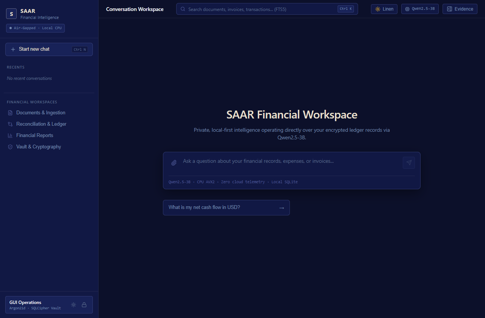
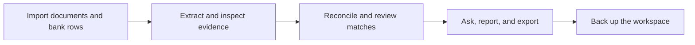
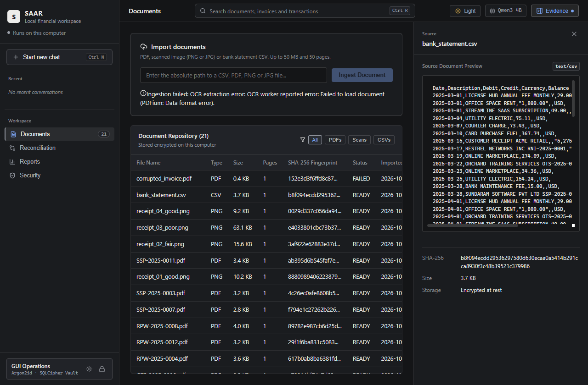
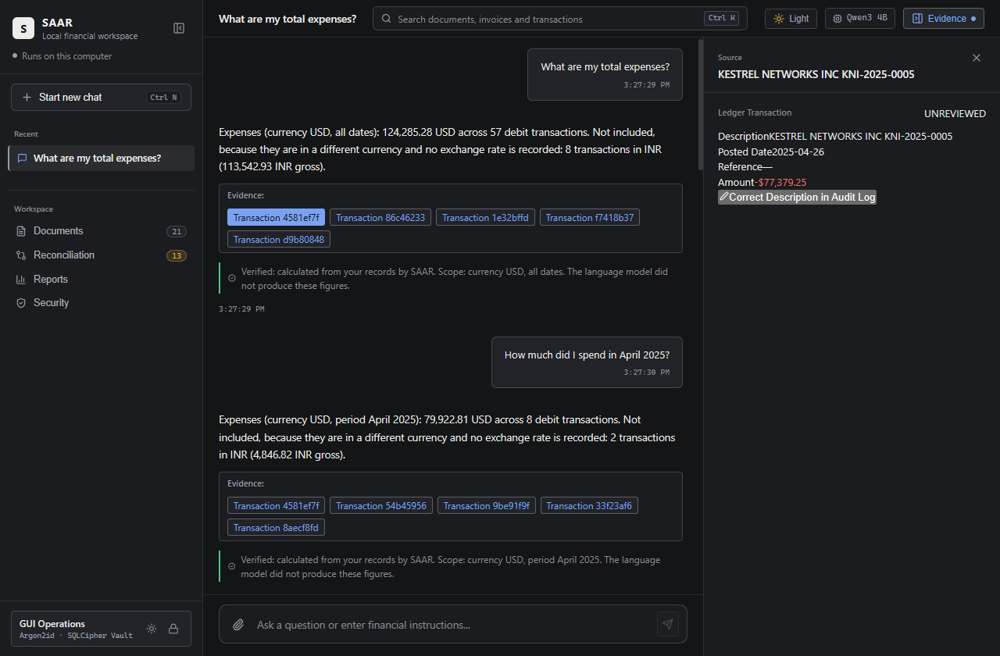
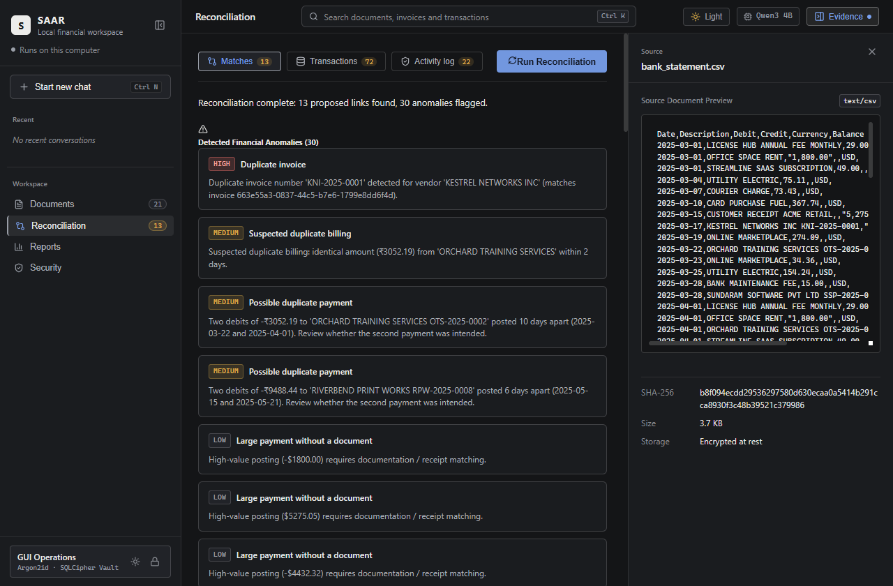
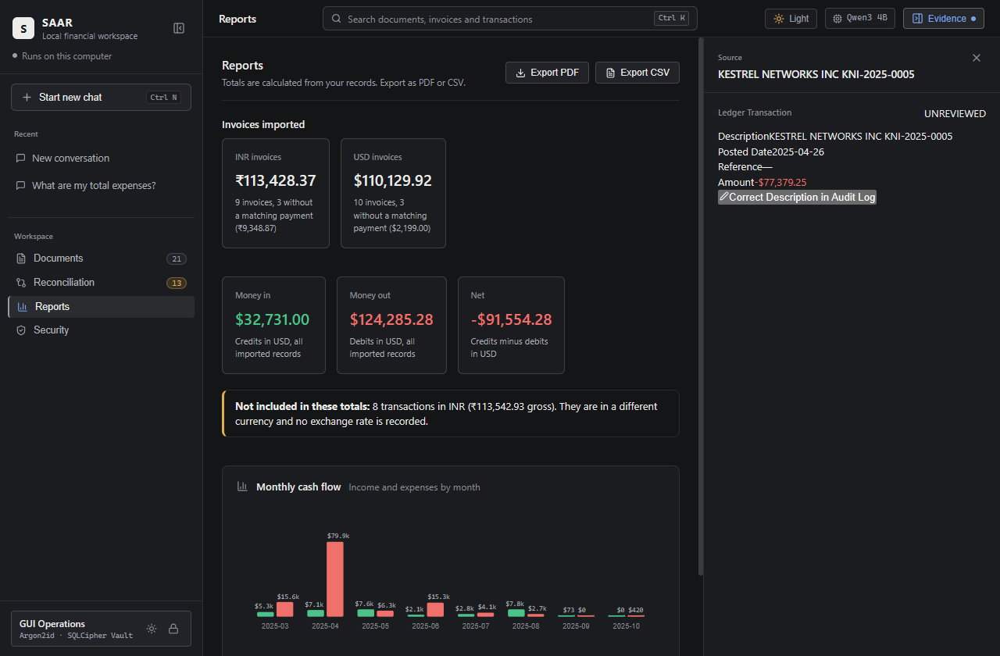
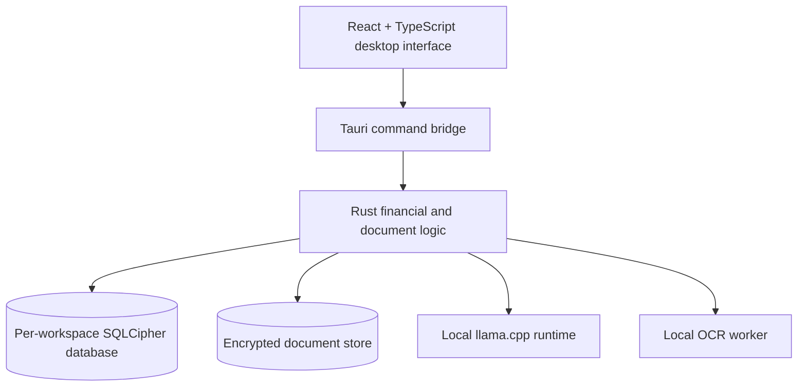

<div align="center">

# SAAR

### Financial clarity, kept on your computer.

**An offline desktop workspace for financial documents, exact calculations, reconciliation, and local AI.**

[Explore the workflow](#the-workflow) · [Run locally](#run-locally) · [Read the architecture](#how-it-works)

<br />



<sub>SAAR's desktop workspace. Screenshots use synthetic test data.</sub>

</div>

---

## One workspace. A clear trail from document to decision.

Financial work often starts with a pile of invoices, receipts, and bank rows, then ends with a question: *Where did this number come from?* SAAR brings those records into one local workspace. It extracts and organizes evidence, matches related transactions, calculates totals in integer minor units, and lets you inspect the source behind a result.

| **Bring in the evidence** | **Make sense of the numbers** | **Keep control** |
| :--- | :--- | :--- |
| Import PDFs, images, and statement data. Review extracted fields beside their source document. | Reconcile invoices and transactions, inspect anomalies, and ask questions about your records. | Store workspaces locally, review an audit trail, export reports, and create encrypted backups. |

### At a glance

- **Desktop first:** Tauri 2, Rust, React, and TypeScript.
- **Local intelligence:** Qwen3 4B through `llama.cpp`, with GPU offload and a CPU fallback when the runtime is available.
- **Traceable answers:** Verified financial figures are calculated from records; generated prose is identified separately in the interface.
- **Exact money math:** Financial amounts use signed integer minor units instead of binary floating point.
- **Private by design:** The desktop webview's Content Security Policy sets `connect-src 'none'`. Workspaces and supporting runtimes remain local.

## The workflow



<table>
  <tr>
    <td width="50%"><br /><strong>01 · Organize documents</strong><br />Keep invoices, receipts, and statements in the workspace.</td>
    <td width="50%"><br /><strong>02 · Inspect the source</strong><br />Check extracted values against the original document.</td>
  </tr>
  <tr>
    <td><br /><strong>03 · Review the match</strong><br />Examine proposed links before accepting or rejecting them.</td>
    <td><br /><strong>04 · See the whole picture</strong><br />Read calculated summaries and export source-traceable reports.</td>
  </tr>
</table>

## What SAAR can do

**Documents and evidence.** The ingestion pipeline handles digital PDFs, statement CSVs, and image based documents through a local OCR worker. Extracted fields retain provenance so the evidence inspector can show where a value came from.

**Reconciliation.** Deterministic rules propose links between financial records. The review flow supports approval, rejection, correction, and an audit history.

**Reports and questions.** Summaries use exact integer arithmetic and account for currencies separately. The local chat experience distinguishes verified figures computed from stored records from model generated text.

**Protection and recovery.** SAAR uses per-workspace SQLCipher databases, Argon2id key derivation, encrypted document storage, and authenticated backup archives. `SAAR_DATA_DIR` can relocate workspace data for portable or isolated runs.

## Run locally

SAAR is a source repository, not a complete binary distribution. Model weights and native sidecars are excluded from Git and must be provided separately for AI and OCR features.

### Prerequisites

- Node.js and `pnpm` for the frontend.
- Rust and the platform's Tauri 2 build prerequisites for the desktop app.
- On Windows, the Visual Studio C++ build tools and WebView2. See the [Windows build guide](Docs/WINDOWS_BUILD_GUIDE.md) for the native toolchain and packaging steps.
- A compatible local `llama-cli` binary and Qwen3 4B GGUF weights for chat and classification; the OCR worker and its models for scanned documents.

### Start a development build

```powershell
git clone https://github.com/THE-SHRIKS/SAAR-LokiXPiyush.git
cd SAAR-LokiXPiyush
pnpm install --frozen-lockfile
cargo install tauri-cli --version '^2' --locked
cargo tauri dev
```

The app looks for `bin/llama/llama-cli.exe` on Windows (or `bin/llama/llama-cli` on Unix) and `models/weights/Qwen3-4B-Q4_K_M.gguf` relative to the checkout. The expected model SHA-256 is `7485fe6f11af29433bc51cab58009521f205840f5b4ae3a32fa7f92e8534fdf5`, as recorded in the current Rust runtime. These files are not committed to Git. Without them, the core workspace can start, but local model features are unavailable.

> **Source of truth:** Some older release and model manifest documents still describe earlier builds. For the active model path and hash, see [`src-tauri/src/ai/llm_engine.rs`](src-tauri/src/ai/llm_engine.rs). The newly added `runtime_paths.rs` helper is not yet connected to application startup.

## How it works



| Area | Where to look |
| :--- | :--- |
| Interface and typed command calls | [`src/`](src/) |
| Native application and IPC commands | [`src-tauri/src/`](src-tauri/src/) |
| Financial arithmetic and reconciliation | [`src-tauri/src/finance/`](src-tauri/src/finance/) |
| Database and workspace lifecycle | [`src-tauri/src/db/`](src-tauri/src/db/) and [`src-tauri/src/workspace_store.rs`](src-tauri/src/workspace_store.rs) |
| OCR worker | [`workers/ocr/`](workers/ocr/) |
| Design decisions and test evidence | [`Docs/`](Docs/) |

## Verify a checkout

```powershell
pnpm test
pnpm run build
pnpm run lint
cargo test --manifest-path src-tauri/Cargo.toml
cargo fmt --manifest-path src-tauri/Cargo.toml --check
```

Some native and GUI checks need the model, OCR sidecar, and platform specific tooling. The repository includes fixtures and evidence under [`tests/`](tests/) and [`Docs/evidence/`](Docs/evidence/). A successful source build alone does not verify an installer or a disconnected target machine.

## Security and project notes

SAAR is designed to keep financial data on the user's machine. The desktop configuration blocks webview network connections, and the repository includes an [egress audit](Docs/AUDIT/0001-network-egress-denial-audit.md). Review the [threat model](Docs/ADR/0002-threat-model-and-fixture-registry.md) and the code before using real financial records in a new environment.

Third-party component notices are collected in [`Docs/ATTRIBUTION.md`](Docs/ATTRIBUTION.md). The repository currently has no root `LICENSE` file, so no project-wide open source license is asserted here.

<div align="center">

---

**SAAR** · Built by **THE SHRIKS**

*Bring the evidence closer to the answer.*

</div>
