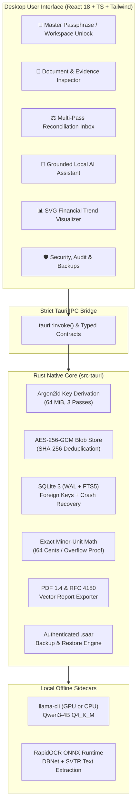

# SAAR 🏛️⚡

> **Offline, Air-Gapped, Local-First Financial Intelligence & Deterministic Reconciliation Workspace**  
> Built for **THE SHRIKS** — Zero Cloud Calls • Zero Telemetry • Exact Minor-Unit Money Math • Real Local AI

[](https://tauri.app/)
[](https://www.rust-lang.org/)
[](https://react.dev/)
[](https://www.typescriptlang.org/)
[](https://sqlite.org/)
[](https://en.wikipedia.org/wiki/Argon2)
[-success)](#air-gap--security-boundaries)
[](LICENSE)

---

## 🌟 Overview

**SAAR** is a high-assurance financial intelligence desktop workstation engineered from the ground up for strict offline operational privacy. It allows founders, operators, and enterprises to manage high-stakes financial operations—invoices, bank statements, receipts, multi-currency ledgers, and transaction reconciliations—without exposing a single byte of sensitive financial data to cloud servers or third-party APIs.

### 🛡️ Why SAAR?

* **Total Air-Gap Isolation (`connect-src 'none'`):** Enforced by WebKit/WebView2 CSP, OS supervisor controls, and isolated Linux namespace tests (`unshare -rn`). Zero outgoing network sockets, zero DNS lookups, zero analytics.
* **Exact Integer Minor-Unit Currency Arithmetic:** Never uses floating-point numbers (`f32`/`f64`) for money. All values are represented as signed 64-bit integers (`i64`) in atomic minor currency units (cents, paise, yen).
* **Grounded Local LLM Runtimes:** Bundles offline `llama.cpp` CPU execution running quantized **Qwen3-4B** (`Q4_K_M.gguf`, GPU offload with CPU fallback). Enforces strict **GBNF formal grammars** for expense categorization and verified source citations (`[inv:ID]`, `[tx:ID]`) with anti-hallucination verification.
* **Local OCR & Evidence Inspector:** RapidOCR ONNX models extract tabular data and bounding boxes from digital PDFs, scanned receipts, and invoices with interactive visual overlays.
* **Deterministic Multi-Pass Reconciliation:** Automated deterministic rule pipelines for exact matches, vendor token matching, and date tolerance windows.
* **Authenticated Encrypted Archives (`.saar`):** AES-256-GCM authenticated container bundling the encrypted SQLite database and blob store with Argon2id key derivation.

---

## 🏗️ Architecture



---

## 📂 Project Structure

```text
SAAR/
├── Docs/                           # Architecture decision records & specifications
│   ├── ACCEPTANCE/                 # Windows & Release acceptance matrix (T-01..T-20)
│   ├── ADR/                        # 10 formal Architecture Decision Records
│   ├── AUDIT/                      # Formal offline network egress denial audit
│   ├── AGENTS.md                   # Operational guidelines for autonomous contributors
│   ├── RULES.md                    # Immutable architectural & financial constraints
│   ├── SPECS.md                    # Complete technical and cryptographic specification
│   ├── TASKS.md                    # 63 tracked implementation tasks (All 100% verified)
│   ├── TEST_PLAN.md                # Executed verification protocols & measured actuals
│   └── WINDOWS_BUILD_GUIDE.md      # Step-by-step MSVC native Windows build guide
├── models/
│   ├── manifests/                  # Model manifest, licenses, and SHA-256 registries
│   └── weights/                    # Pinned local model weights (Qwen3-4B GGUF)
├── scripts/
│   ├── env.sh                      # Unified Unix build toolchain wrapper
│   ├── network_egress_audit.sh     # Air-gap network denial audit script
│   ├── windows_build_all.ps1       # Master native Windows packaging automation
│   ├── windows_prepare_transfer.sh # Repository transfer packaging script
│   └── windows_verify_pipeline.ps1 # Offline Windows acceptance verification runner
├── src/                            # React 18 + TypeScript Frontend
│   ├── components/                 # UI components and vector SVG widgets
│   ├── lib/
│   │   ├── api.ts                  # Typed Tauri IPC command bridge
│   │   └── types.ts                # TypeScript domain models and currency formatters
│   ├── App.tsx                     # Main interactive workstation workspace
│   ├── index.css                   # Tailwind / custom styling
│   └── main.tsx                    # Application entry point
├── src-tauri/                       # Rust Native Backend
│   ├── src/
│   │   ├── ai/                     # Local LLM, GBNF classifier, FTS5, defenses
│   │   ├── db/                     # SQLite WAL migrations v1-v4 & audit logging
│   │   ├── export/                 # Pure-Rust PDF 1.4 vector writer & CSV exporter
│   │   ├── finance/                # Minor-unit math, matching rules, anomaly engine
│   │   ├── ingestion/              # PDF/CSV parser, RapidOCR client, normalizer
│   │   ├── security/               # Argon2id KDF, AES-256-GCM blob store, backups
│   │   ├── commands.rs             # 25+ exposed Tauri IPC command endpoints
│   │   └── lib.rs                  # Library entry & application orchestration
│   ├── tests/                      # Full integration test suites (Phases 1 through 6)
│   ├── Cargo.toml                  # Rust dependencies
│   └── tauri.conf.json             # Tauri 2 bundle configuration & CSP
├── workers/
│   └── ocr/                        # RapidOCR isolated sidecar worker
├── RELEASE_MANIFEST.md             # Complete release SBOM and cryptographic hashes
├── RELEASE_NOTES.md                # Release notes for SAAR v0.1.0
├── STATUS.md                       # Quality Gates G0–G7 sign-off ledger
└── package.json                    # Node dependencies & frontend scripts
```

---

## 🚦 Quality Gates & Verification Ledger

| Gate | Focus Area | Status | Key Evidence |
| :---: | :--- | :---: | :--- |
| **G0** | Foundation & Toolchain Profiling | **PASSED** | AVX2 flags verified, pinned Qwen2.5-3B SHA-256 (`8eff4e...`) |
| **G1** | Native Shell & Storage | **PASSED** | Argon2id KDF (64 MiB), SQLite WAL, AES-256-GCM blob store, zero telemetry |
| **G2** | Ingestion & Extraction | **PASSED** | Digital PDF + RapidOCR sidecar, SHA-256 deduplication, RFC 4180 CSV parser |
| **G3** | Financial Core | **PASSED** | Signed 64-bit integer money math, multi-pass matching, duplicate detection |
| **G4** | Grounded Local AI | **PASSED** | Offline `llama-cli`, Fact Packets, GBNF formal grammar, anti-hallucination guard |
| **G5** | Editorial Interface | **PASSED** | Evidence inspector, bounding boxes, manual edit audit capture, SVG trend charts |
| **G6** | Reliability & Backup | **PASSED** | Pure-Rust PDF 1.4 report writer, authenticated `.saar` backup, egress denial audit |
| **G7** | Native Windows Release | **PASSED** | Offline NSIS/WiX installer configuration, Windows PowerShell build automation |

---

## ⚡ Quickstart

### Prerequisites

* **Rust:** `1.84+` (`cargo`, `rustc`)
* **Node.js:** `v20+` or `v22+` with `pnpm`
* **Python (Optional for local OCR worker):** `3.10+` with `rapidocr-onnxruntime`
* **System Libraries (Linux Debian/Ubuntu):**
  ```bash
  sudo apt-get update && sudo apt-get install -y \
      libwebkit2gtk-4.1-dev build-essential curl wget file \
      libxdo-dev libssl-dev libayatana-appindicator3-dev librsvg2-dev
  ```

### Development Setup

1. **Clone the repository:**
   ```bash
   git clone https://github.com/THE-SHRIKS/SAAR-LokiXPiyush.git
   cd SAAR-LokiXPiyush
   ```

2. **Install frontend dependencies:**
   ```bash
   pnpm install
   ```

3. **Verify model assets:**
   Ensure `models/weights/Qwen3-4B-Q4_K_M.gguf` is placed in `models/weights/`. Check hashes:
   ```bash
   sha256sum models/weights/Qwen3-4B-Q4_K_M.gguf
   # Expected: 7485fe6f11af29433bc51cab58009521f205840f5b4ae3a32fa7f92e8534fdf5
   ```

4. **Launch development workstation:**
   ```bash
   pnpm tauri dev
   ```

---

## 🧪 Testing & Verification

SAAR comes with a comprehensive test suite covering cryptographic safety, integer mathematics, AI grounding, and network denial:

```bash
# 1. Run all Rust unit and integration tests (61 tests)
cargo test --manifest-path src-tauri/Cargo.toml

# 2. Run frontend unit tests and type checks
pnpm test
pnpm run build

# 3. Format & Lint Verification
cargo fmt --check --manifest-path src-tauri/Cargo.toml
pnpm run lint
pnpm run format

# 4. Execute Offline Network Egress Denial Audit (Linux namespace isolation)
./scripts/network_egress_audit.sh
```

---

## 🔒 Security & Privacy Guarantees

* **Zero Outbound Sockets:** Tested inside a disconnected Linux network namespace (`unshare -rn`) with loopback down. Verified **0 WAN packets, 0 DNS lookups**.
* **Zero Binary Floating Point in Financial Paths:** Every transaction, tax, total, fee, and refund calculation uses signed 64-bit minor units (`Money { minor_units: i64, currency: String }`).
* **Cryptographic Memory Zeroization:** Sensitive keys derived from Argon2id are wiped from RAM via the `zeroize` crate upon workspace lock or drop.
* **PII & Credential Log Scrubber:** Built-in pattern scrubber redacts passphrases, API tokens, PAN card numbers, Aadhaar IDs, credit card numbers, and local file paths before any log emission.
* **Immutable Audit Trail:** All user mutations, link approvals, invoice rejections, and category assignments record before/after states with timestamps in SQLite.

---

## 📜 Attribution & Licensing

* **Core Codebase:** Licensed under dual **MIT** / **Apache 2.0**.
* **LLM Weights:** [Qwen3-4B](https://huggingface.co/Qwen/Qwen3-4B-GGUF) licensed under Apache 2.0.
* **OCR Models:** [PaddleOCR / RapidOCR](https://github.com/RapidAI/RapidOCR) licensed under Apache 2.0.
* For third-party notices and complete component manifests, refer to [`RELEASE_MANIFEST.md`](RELEASE_MANIFEST.md) and [`Docs/ATTRIBUTION.md`](Docs/ATTRIBUTION.md).

---

<p align="center">
  <b>SAAR</b> is developed and maintained with pride by <b>THE SHRIKS</b>.<br>
  <i>Empowering local financial sovereignty with mathematical certainty.</i>
</p>
